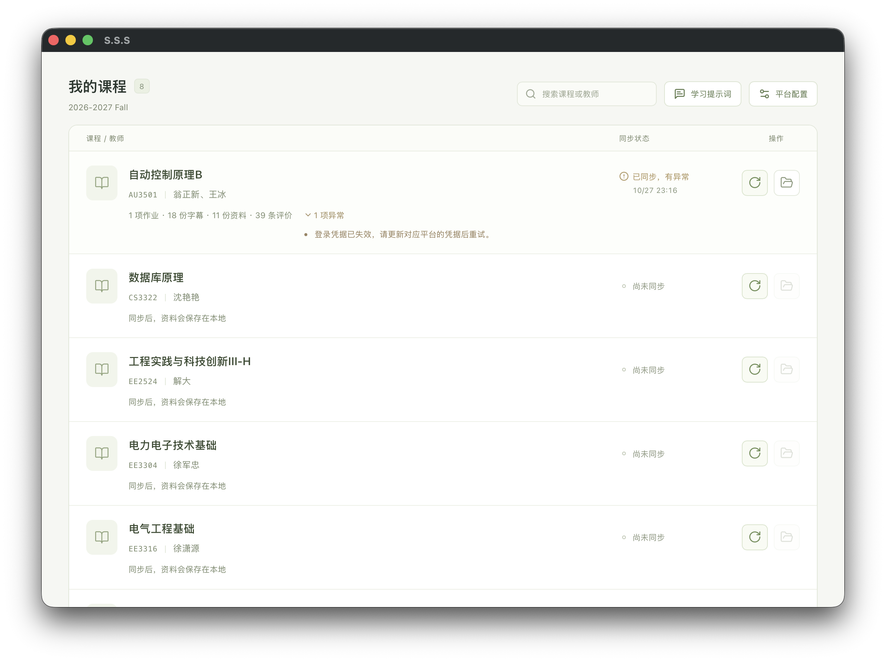
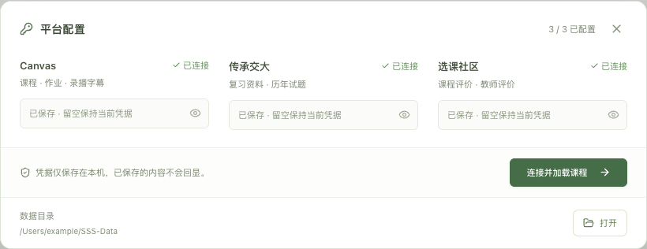
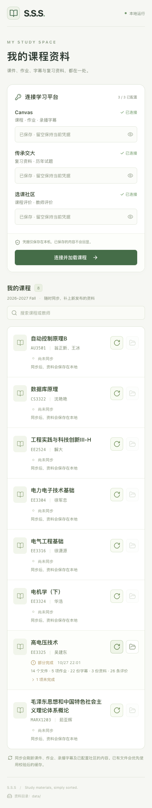

<div align="center">
  
  <h1>S.S.S</h1>
  <p><strong>SJTU速通套件</strong></p>
  <p>把 Canvas、传承交大和选课社区的资料，整理成一份可以慢慢读的本地课程档案。</p>

  <p>
    <a href="https://github.com/KiloxGo/S.S.S/actions/workflows/test.yml"></a>
    
    
    
    
  </p>

  <p>
    <a href="#快速开始">快速开始</a> ·
    <a href="#命令行">命令行</a> ·
    <a href="#本地页面">本地页面</a> ·
    <a href="#用-ai-学习">用 AI 学习</a> ·
    <a href="#文档">文档</a>
  </p>
</div>

<p align="center">
  
  <sub>桌面应用：课程列表、一键同步与学习提示词</sub>
</p>

<details>
<summary>平台配置与便携数据目录</summary>
<p align="center">
  
</p>
</details>

## 它是什么

**S.S.S** 是一个本地优先的课程资料采集工具。它从 Canvas 拉取课件、作业与录播字幕，从传承交大收集复习资料，从选课社区整理教师评价，按学期和课程归档为可直接浏览的 HTML / Markdown，并附带一套给 AI Agent 的学习提示词。

- **一处归档** —— 三个来源的资料按课程归并，同学期、同课程号的多个 Canvas 空间自动合并。
- **双阅读入口** —— 每个阅读层级都生成 `index.html`（人读）与 `README.md`（Agent 读），链接各自闭环。
- **不重复存储** —— 按 SHA-256 去重；跨空间、跨来源的相同文件只留一份，其他位置链接过去。
- **本地优先** —— 凭据只存在本机 `.env`，不写进阅读页；页面只监听 `127.0.0.1`。
- **增量且可恢复** —— 下载缓存与状态 SQLite；单个来源失败不影响其他来源，重跑即可继续。
- **为 AI 学习而设** —— 每门课生成 `AGENTS.md`、`CLAUDE.md`、`SCHEMA.md`、`PROMPTS.md`，内置六种学习任务。

## 快速开始

桌面版面向 Windows 和 macOS：解压对应系统的便携包，双击应用，在“平台配置”中填写凭据即可使用，无需安装 Python 或 Node.js。数据可随 `SSS-Data` 目录迁移。当前为未配置发布者签名的开发构建；构建方式、数据位置和系统要求见 [`docs/desktop-packaging.md`](docs/desktop-packaging.md)。

以下是源码运行方式。

需要 Python 3.11.8+；网页界面还需要 Node.js 20.19+ 或 22.12+。

```bash
git clone https://github.com/KiloxGo/S.S.S.git
cd S.S.S

python3 -m venv .venv
source .venv/bin/activate          # Windows PowerShell: .\.venv\Scripts\Activate.ps1
python -m pip install -e ".[web]"
```

安装后也可以直接使用 `sss` 命令；下文统一写作 `python -m sss`。解压 RAR 需要 PATH 中有 `unrar` 或 `unar`，ZIP / TAR / 7Z 无需外部命令。

复制凭据模板，填写你要使用的平台；只填一个也可以：

```bash
cp .env.example .env               # Windows PowerShell: Copy-Item .env.example .env
```

```bash
python -m sss doctor                 # 未配置的平台会提示缺失，不影响已配置来源
python -m sss sync --course EE3316
```

资料会写到 `data/<学期>/<课程号>-<课程名>/`。打开其中的 `index.html` 即可浏览，或让 Agent 从 `README.md` 开始阅读。

## 输出结构

```text
data/2026-2027 Fall/EE3316-电气工程基础/
├── index.html / README.md        # 人 / Agent 的阅读入口
├── canvas/
│   └── 93532-徐潇源/
│       ├── files/                # 课件与课程文件
│       ├── assignments/          # 作业：question/ 与 solution/ 分开
│       └── subtitles/            # 录播字幕（仅 SRT）
├── share/                        # 传承交大资料（按原上传标题）
└── reviews/                      # 选课社区教师评价
```

## 命令行

| 命令 | 说明 |
| --- | --- |
| `python -m sss doctor` | 检查三个平台的认证，不回显凭据 |
| `python -m sss courses` | 列出本学期课程；`--all` 列出全部学期，`--term` 指定学期 |
| `python -m sss plan --course EE3316 --out .local/EE3316.json` | 生成可编辑的课程映射 |
| `python -m sss sync --plan .local/EE3316.json` | 按映射同步 |
| `python -m sss sync --course EE3316 --output D:\Study` | 一步同步到指定目录 |
| `python -m sss web` | 启动本地页面（默认 `127.0.0.1:8765`） |

只刷新部分来源：

```bash
python -m sss sync --plan .local/EE3316.json --sources canvas,subtitles
```

退出码 `0` 表示所选来源完成，`2` 表示有未取到的内容或配置问题。映射格式见 [`examples/course.json`](examples/course.json)；目录细节见 [`docs/schema.md`](docs/schema.md)。

## 本地页面

主页直接列出当前学期的课程，右侧按钮分别用于同步和打开本机课程目录；同步状态、失败原因和已有资料都在同一页展示。

- 右上角“平台配置”填写凭据，保存到本机 `.env`；已保存的值不会回传。
- 同步在后台串行执行，刷新页面不影响任务，服务重启后可恢复上次结果。
- “学习提示词”提供课程指南、字幕中的考核与安排、考前复习、作业与实验清单、知识点辅导、同步后更新六种任务。

首次使用网页界面时，先构建静态资源再启动：

```bash
npm --prefix web ci
npm --prefix web run build
python -m sss web
```

需要改端口或资料目录时，使用 `--port 8766`、`--output D:\Study`。前端开发时同时运行 `python -m sss web` 与 `npm --prefix web run dev`，Vite 会把 `/api` 转发到 8765。

<details>
<summary>手机布局</summary>
<p align="center">
  
</p>
</details>

## AI 辅助学习

同步会在每门课根目录生成 `AGENTS.md`、`CLAUDE.md`、`SCHEMA.md` 和 `PROMPTS.md`。把课程文件夹交给 Agent，先读学习约定，再按 `README.md` / `SCHEMA.md` 查资料；重点核查字幕里的考试、评分、实验、签到、范围和作业注意点，结论需带文件、页码或字幕时间戳。

个人的学习笔记放在课程 `notes/`，后续同步会保留；已有手写的 Agent 说明也不会被模板覆盖。任务细节见 [`docs/study-prompts.md`](docs/study-prompts.md)。

## 凭据与边界

<details>
<summary>三个平台凭据怎么填</summary>

- `SSS_CANVAS_TOKEN`：`oc.sjtu.edu.cn` 账户设置中的 API Token，只填原值，不加 `Bearer `。
- `SSS_SHARE_TOKEN`：登录 `share.dyweb.sjtu.cn` 后，在开发者工具 Application → Local Storage 读取 `token`，去掉 JSON 外层双引号。
- `SSS_REVIEWS_COOKIE`：直接粘贴 `course.sjtu.plus` 的 `jcourse_session` 原始值，程序会自动补上 Cookie 名。

</details>

`.env`、`data/` 与 `.local/` 均被 Git 忽略。凭据不会写进阅读页，签名 URL 中的凭据参数也不会保留。

只获取账号可访问的内容；不下载视频本体、不提交作业；传承交大只获取明确为 0 积分的资料，并在购买前复查价格。请遵守学校和平台的规定，仅用于个人学习。

## 文档

| 文档 | 说明 |
| --- | --- |
| [`docs/schema.md`](docs/schema.md) | 输出目录与文件规范 |
| [`docs/study-prompts.md`](docs/study-prompts.md) | 学习提示词与 Agent 入口 |
| [`docs/desktop-packaging.md`](docs/desktop-packaging.md) | Windows / macOS 桌面打包与便携数据 |
| [`.env.example`](.env.example) | 三个平台的凭据模板 |
| [`examples/course.json`](examples/course.json) | 课程映射示例 |
| [`AGENTS.md`](AGENTS.md) | 仓库开发与学习约定 |

## 开发与验证

```bash
python -m pip install -e ".[web,test]"
python -m pytest -q

npm --prefix web run build
npm --prefix web test
```
